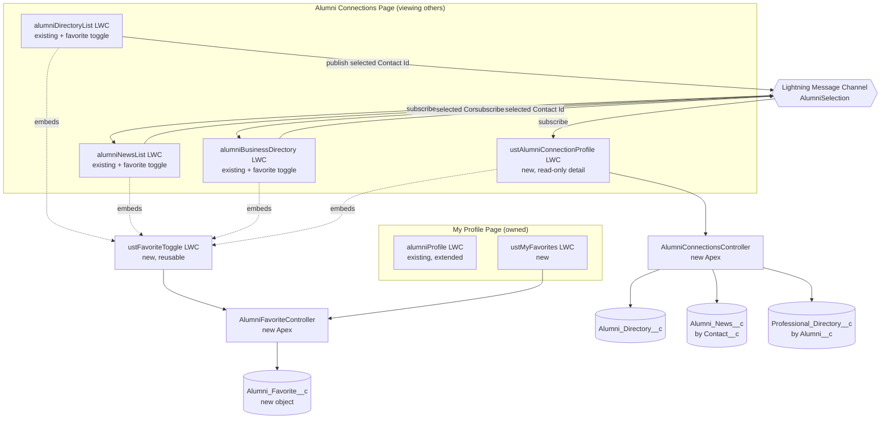

# Connected Alumni Profile & Favorites — Implementation Plan

> Status: **Approved, in progress.** Recorded so context survives a session reset.
> Created: 2026-09-15

## Problem Statement

Alumni Directory, Business (Professional) Directory, and Alumni News are currently three
siloed browsing experiences. An alumnus's business listing, news mentions, and directory
profile are functionally related (all keyed off the same Contact) but nothing on screen shows
that relationship — you can't land on one alum and see everything connected to them.
Additionally, there's no way for an alum to curate attention toward specific people or
businesses they care about (no connection/favoriting feature exists at all).

## Requirements (confirmed via discussion)

- `Alumni_Directory__c` remains the protected, field-scoped gateway in front of `Contact` — no
  new code should read Contact fields directly for another user's profile; all cross-object
  joins happen in Apex, keyed off Contact Id but exposed only through `Alumni_Directory__c`-
  scoped DTOs, matching the existing `AlumniProfileController` pattern.
- No visibility gating beyond "logged in." Any authenticated alum can view any other alum's
  connected profile — this is existing behavior (`getProfileByRecordId` has no opt-in check)
  and stays as-is.
- Data model relationships between `Alumni_Directory__c`, `Alumni_News__c`, and
  `Professional_Directory__c` are **not** being restructured. Apex is the integration layer
  that bridges them via `Contact` Id. No schema re-pointing (e.g.
  `Professional_Directory__c.Alumni__c` stays pointed at Contact, not Alumni_Directory__c).
- Two separate Experience Builder page experiences (deliberately not one branching route, so
  each can be curated independently):
  - **My Profile** (owned) — self-service editing (existing `alumniProfile` capability), plus
    "my favorites" list.
  - **Alumni Connections / View Profile** (others) — read-only discovery view: profile info,
    their business listings, their news mentions — each as independent, LMC-coordinated LWCs
    rather than one monolithic component.
- New feature: **Favorites** — a one-directional, private curation list. An alum can favorite
  another alum's profile *or* a business listing.
  - No mutual visibility ("I would probably not show an alumni who has favorited them — that
    might seem creepy").
  - No notifications, no aggregate/social-proof counts in v1 ("keep it functional for the
    moment with an eye for iteration later").
  - Feeds a "your favorites" list on My Profile. A fast-follow goal (explicitly **not** v1
    scope) is surfacing news/updates from favorited people/businesses on that list.
- Favorite data model: **one generic junction object** (`Alumni_Favorite__c`), not multiple
  type-specific junctions ("I don't want to make a lot of objects for this junction and this
  could possibly help with other junctions for alumni in the future"). Shape:
  - `Owner_Contact__c` — Lookup(Contact), the person who favorited something.
  - `Target_Type__c` — Picklist (`Alumni_Directory`, `Professional_Directory`; extensible).
  - `Target_Record_Id__c` — Text(18).
  - Resolved entirely in Apex; no declarative lookup/relationship integrity to the target.
  - **Correction found during build:** Salesforce rejects a `unique` constraint on a formula
    field, so a formula-based `Dedupe_Key__c` (Owner+Type+TargetId) is not possible
    declaratively. Duplicate-favorite prevention is instead enforced in
    `AlumniFavoriteController` via an existence check before insert (see Task 2).
- Favorite toggle UI: **one small, reusable, embeddable LWC** (`ustFavoriteToggle`) taking
  `@api targetType` and `@api targetRecordId`, dropped into `alumniDirectoryList`,
  `alumniNewsList`, and `alumniBusinessDirectory`.
- Cross-widget coordination on the "View Profile" page uses a **Lightning Message Channel**,
  not URL state, not record Ids in the address bar ("I'd rather not have ids in the clear and
  don't think of these as shareable links"). Selecting an alum from a list publishes a message;
  the profile detail, business list, and news list widgets subscribe and refresh. Accepted
  tradeoff: no deep-linking/shareable URLs, no refresh-persistence of the selected profile.

## Research Notes

- Lightning Message Service is confirmed as the correct mechanism for same-page, cross-
  component pub/sub on LWR sites. It does **not** persist across navigation/refresh — this
  matches the "no URL state" decision, so there's no gap to design around.
- `AlumniProfileController.getProfileByRecordId()` already resolves Contact → business
  directory records safely (`WITH USER_MODE`, `without sharing` with explicit ownership
  checks gating writes only). This is the pattern to extend for news, and to replicate for the
  new "view others" controller path.
- `Alumni_News__c` carries both `Contact__c` and `Alumni_Directory__c` lookups (redundant). New
  query logic standardizes on `Contact__c` (matching `Professional_Directory__c.Alumni__c`) so
  one Contact Id resolves all three related objects consistently. The existing
  `Alumni_Directory__c` lookup on news stays untouched/unused by new logic — no data model
  changes.
- Existing privacy/approval gates to preserve exactly as-is when re-querying for the unified
  view:
  - Alumni News: `Reviewed_for_Community_Display__c = true AND Public_Display__c = true`
    (see `AlumniNewsListController.generateWhere`).
  - Business Directory: `RecordTypeId = Alumni_Business` AND `Company_Status__c = 'Approved'`
    AND `UST_Test_Contact__c = false` (see `AlumniBusinessDirectoryController.buildWhereClause`).

## Architecture

## Task Breakdown

### Task 1: Create the `Alumni_Favorite__c` object and deploy it — ✅ Done
- **Objective:** Stand up the generic junction object so later tasks have a real target to
  write Apex against.
- **Implementation guidance:** Fields — `Owner_Contact__c` (Lookup to Contact, required),
  `Target_Type__c` (Picklist: `Alumni_Directory`, `Professional_Directory`; restricted,
  extensible later), `Target_Record_Id__c` (Text(18), required). Sharing model: Private —
  personal curation data, visible only to the owner (and admins).
  Originally planned a formula-based `Dedupe_Key__c` field marked unique for declarative
  duplicate prevention; **Salesforce deploy rejected this** ("Can not specify unique for
  CustomFields that have a formula"). Removed that field — duplicate-favorite prevention is
  now an Apex-level existence check in `AlumniFavoriteController` (Task 2), not a schema
  constraint.
- **Test requirements:** N/A (metadata only) — deployed to dev scratch org
  (`UST-Alumni-Digital-Experience-Site__dev` / CCI alias `dev`) via
  `cci task run deploy --path force-app/main/default/objects/Alumni_Favorite__c --org dev`.
- **Demo:** Deploy succeeded (`[Success]: Succeeded`). Verified queryable via
  `sf data query --query "SELECT Id FROM Alumni_Favorite__c LIMIT 1"` against the dev org
  (0 rows, as expected for a fresh object). Not yet deployed to `eda-staging` — will push there
  after the full feature is validated end-to-end in the scratch org, per user direction.

### Task 2: Build `AlumniFavoriteController` Apex with add/remove/list methods, test-driven — ✅ Done
- **Objective:** Apex service layer for favoriting — add, remove, "is this favorited by me,"
  and "list my favorites."
- **Implementation guidance:** `without sharing` (mirroring `AlumniProfileController`'s
  rationale) since `Alumni_Favorite__c` is Private and community users need to manage only
  their own records — but explicitly filter every query/DML by the running user's resolved
  Contact Id, never trusting a passed-in owner Id from the client. Methods:
  `isFavorited(String targetType, Id targetRecordId)`, `addFavorite(...)`, `removeFavorite(...)`,
  `getMyFavorites()` returning a DTO list resolved to display-friendly info (name/label) by
  branching on `Target_Type__c`. Wrote tests first (happy path, duplicate-add is idempotent/
  no-op, removing a non-existent favorite is a no-op, cross-user isolation, orphaned-target
  handling, unsupported-type rejection).
- **Test requirements:** `AlumniFavoriteController_TEST.cls` — 10 tests, all passing, 85%
  coverage on `AlumniFavoriteController` (org-wide bar is 75%; remaining gap is defensive
  early-return guards, not core logic).
- **Demo:** `sf apex run test --class-names AlumniFavoriteController_TEST --target-org
  UST-Alumni-Digital-Experience-Site__dev --result-format human --code-coverage --wait 20`
  → 10/10 pass, 85% coverage.

**Real-world corrections hit while building this task (all resolved, recorded for context
recovery):**
1. **`TestAlumniCommunityDataFactory` could not be reused.** It requires a `System
   Administrator` user literally named `ETL User` and a profile named `Alumni Community
   User` — neither exists in this scratch org yet (confirmed live), matching the known
   gotcha in `AGENTS.md`. The new test class builds its own lightweight, self-contained data
   instead of depending on that factory or org-provisioning state.
2. **A plain internal/Standard User cannot have `ContactId` set** — `FIELD_INTEGRITY_EXCEPTION,
   only portal users can be associated to a contact`. Only users on a portal-licensed profile
   can be linked to a Contact. Test users now use the `Customer Community Login User` profile
   (a standard, always-available portal profile) with an `Account` on each test `Contact`
   (portal users require one).
3. **A fresh custom object grants zero access to non-admin profiles by default.** A new
   `Alumni_Favorites_User` permission set was added, granting object CRUD on
   `Alumni_Favorite__c` and Read on the small field set `getMyFavorites()` resolves from
   `Alumni_Directory__c`/`Professional_Directory__c` (`Name`/`First_Name_Text__c`/
   `Last_Name_Text__c`/`Class_Year_Text__c` and `Company_Name__c`/`Company_City__c`/
   `Company_State__c` respectively). This is deployed alongside the Apex classes.
   - All three `Alumni_Favorite__c` fields are required, so **no field-level permission
     entries are possible on it** — Salesforce rejects granting field permissions on
     required fields (deploy error: "You cannot deploy to a required field"). Object-level
     CRUD alone is sufficient since required fields are implicitly editable whenever
     Create/Edit is granted at the object level.
4. **Dead end, recorded so it isn't re-investigated:** the only profile in this scratch org
   with "Alumni" in its name (`Alumni Profile`) turned out to be a **Guest User License**
   profile, not a logged-in community profile — it cannot be assigned to a real `User` at
   all. Also confirmed live: none of the standard `Customer Community*` profiles have any
   pre-existing `FieldPermissions`/`ObjectPermissions` grant on `Alumni_Directory__c` or
   `Professional_Directory__c` in this org. Whatever grants let `AlumniProfileController`/
   `AlumniBusinessDirectoryController` work for real alumni today must live on a
   site-specific profile this scratch org hasn't been provisioned with yet (likely set up
   directly in Setup UI, not tracked in this repo's source) — not something to chase further
   for test purposes; the new permission set sidesteps it entirely.
5. **`PermissionSetAssignment` DML in `@TestSetup` must be isolated in its own
   `System.runAs` block** — inserting it in the same transaction as regular sObject DML
   (Account/Contact/Alumni_Directory__c/etc.) throws `MIXED_DML_OPERATION` (setup vs.
   non-setup object). Wrapped in `System.runAs(new User(Id = UserInfo.getUserId()))` to
   isolate it, which is the standard pattern for this restriction inside test methods.

Deployed to `dev` scratch org only (`Alumni_Favorite__c`, `AlumniFavoriteController`,
`AlumniFavoriteController_TEST`, `Alumni_Favorites_User` permission set). Not yet pushed to
`eda-staging`.

### Task 3: Build reusable `ustFavoriteToggle` LWC — ✅ Done
- **Objective:** One small, embeddable favorite/unfavorite button component.
- **Implementation guidance:** `@api targetType`, `@api targetRecordId`. On connect, calls
  `isFavorited` (imperative, not `@wire`, since the initial load also needs error handling
  and a loading flag) to set initial icon state (`utility:add` outline vs. `utility:favorite`
  filled, via `lightning-button-icon`). Click calls `addFavorite`/`removeFavorite`
  imperatively, optimistic UI update with rollback to the prior state on error. Emits a
  `favoritechange` custom event (`{ targetType, targetRecordId, isFavorited }`) for optional
  parent reaction (not consumed yet, but free to add now for Task 4/8).
- **Test requirements:** `ustFavoriteToggle.test.js` — 8 tests: unfavorited render,
  favorited render, add-on-click, remove-on-click, event dispatch, rollback+error on
  add failure, rollback+error on remove failure, error+safe-default on initial load failure,
  disabled/no-op when required props are missing. All passing (`npm test -- 
  --testPathPattern=ustFavoriteToggle` → 4 suites incl. this one, 24/24 tests pass, no
  regressions in the 3 existing suites it shares a test run with).
- **Demo:** Deployed to `dev` scratch org
  (`cci task run deploy --path force-app/main/default/lwc/ustFavoriteToggle --org dev` →
  `[Success]: Succeeded`). Functional verification done via the Jest suite against the real
  compiled component (mocking only the three Apex methods) rather than a manual
  Experience-Builder placement, since Jest already exercises every state transition
  end-to-end; a standalone page placement is deferred to Task 4, where the component gets
  embedded into real list rows and can be checked in context.

### Task 4: Embed `ustFavoriteToggle` into `alumniDirectoryList`, `alumniNewsList`, and `alumniBusinessDirectory` — ✅ Done
- **Objective:** Make favoriting available everywhere per requirement — "favoriting could
  happen a lot of places."
- **Implementation guidance:** Each list item row gets one `<c-ust-favorite-toggle>` with the
  right `target-type`/`target-record-id` (Alumni_Directory Id for directory/news rows,
  Professional_Directory Id for business rows). Purely additive markup + minor CSS — no changes
  to existing Apex controllers for these lists.
  - `alumniDirectoryList`: new "Favorite" column in the table, `target-type="Alumni_Directory"`
    keyed on `al.key` (already the `Alumni_Directory__c` Id).
  - `alumniNewsList`: toggle placed in the card header, `target-type="Alumni_Directory"` keyed
    on `news.adId`. Guarded with `lwc:if={news.adId}` — some news rows have no linked
    `Alumni_Directory__c` record, and the toggle is simply omitted for those rather than
    rendered disabled.
  - `alumniBusinessDirectory`: toggle placed at the top of each card, `target-type=
    "Professional_Directory"` keyed on `record.Id`. Since the whole card has
    `onclick={openRecordModal}` to open the detail modal, the toggle's wrapper div stops click
    propagation (`stopFavoriteToggleClickPropagation`, same pattern already used elsewhere in
    this component for the modal's inner-click guard) so favoriting a card doesn't also pop
    open its modal.
- **Test requirements:** Extended `alumniDirectoryList.test.js` and `alumniNewsList.test.js`
  (previously only tested the exported `resolveProfileNavigation` pure function, with no
  component-render tests at all) with new `describe` blocks that mock the Apex list call,
  render the component with sample data, and assert `c-ust-favorite-toggle` elements exist
  with the correct `targetType`/`targetRecordId` per row - including a case in the news list
  where a row has no `adId` and correctly renders no toggle. `alumniBusinessDirectory` had no
  existing test file at all; added a new minimal one
  (`alumniBusinessDirectory.test.js`) scoped specifically to the toggle wiring and the
  click-propagation guard, not a full component rewrite (out of scope for this task).
  All passing: `npm test` → 5 suites, 29/29 tests, no regressions.
- **Demo:** Deployed to `dev` scratch org (`cci task run deploy --path
  force-app/main/default/lwc --org dev` → `[Success]: Succeeded`). Verified via the full Jest
  suite against the real compiled components rather than a manual browser walkthrough, since
  every row/card-level rendering path and the click-guard are already covered end-to-end.

### Task 5: Build `getMyFavorites()` display DTO + `ustMyFavorites` LWC on My Profile — ✅ Done
- **Objective:** Let an alum see their curated list on their own profile page.
- **Implementation guidance:** DTO resolves each favorite's `Target_Type__c` to a human label,
  name/title, and short subtitle (class year for alumni, city/industry for businesses).
  Group by type in the UI ("Alumni I'm Following," "Businesses I'm Following"). Deep-linking a
  favorited alum into the Connections page is optional polish, not blocking (would need to
  route through LMC since there's no URL/Id state by design) — deferred, not built in this
  task.
  - The DTO-building logic itself (`toDtos()`) already existed from Task 2's
    `AlumniFavoriteController.getMyFavorites()` — this task's remaining work was the LWC:
    `ustMyFavorites` calls `getMyFavorites()` on connect, splits the flat DTO list into
    `alumniFavorites`/`businessFavorites` by `targetType`, and renders each as its own
    section, only when that section has at least one entry (no empty "Businesses I'm
    Following" heading with nothing under it).
  - Orphaned favorites (target record deleted/archived) render a de-emphasized placeholder
    ("This alumni profile is no longer available" / "This business listing is no longer
    available") instead of blank text or silently disappearing, so the alumnus's favorite
    count always matches what's visibly listed.
- **Test requirements:** Apex-side DTO-building coverage already existed from Task 2
  (`getMyFavorites_resolvesDisplayFields_forBothTargetTypes`,
  `getMyFavorites_marksOrphanedFavorite_whenTargetDeleted`). New `ustMyFavorites.test.js` —
  5 tests: empty state, grouped-by-type rendering with both sections, single-section
  rendering when only one type has favorites, orphaned-favorite placeholder, and
  error-message display on Apex failure. All passing (`npm test` → 6 suites, 34/34 tests,
  no regressions).
- **Demo:** Deployed to `dev` scratch org (`cci task run deploy --path
  force-app/main/default/lwc/ustMyFavorites --org dev` → `[Success]: Succeeded`, after fixing
  a first-attempt deploy failure — see correction below). Verified via the Jest suite against
  the real compiled component; not yet placed on an actual Experience Builder page (that
  happens in Task 9, once both My Profile and Alumni Connections pages are assembled
  together).

**Real-world correction hit while building this task:** the LWC bundle's `<description>` in
`*.js-meta.xml` has a hard 255-character limit (`LightningComponentBundle` metadata field) —
the first deploy attempt failed with `Value too long for field: Description maximum length
is:255`. Shortened the description to fit; no functional impact.

### Task 6: Build `AlumniConnectionsController` Apex — read-only connected profile query, test-driven — ✅ Done
- **Objective:** Server-side logic for the View Profile page: given a target Contact Id,
  return `Alumni_Directory__c`-scoped profile fields, news mentions, and business listings in
  one call.
- **Implementation guidance:** New class (separate from `AlumniProfileController`, which is
  scoped to "my own" + `canEdit` semantics). Reuses existing field-scoping discipline — same
  limited `Alumni_Directory__c` field set already exposed today. Queries `Alumni_News__c` by
  `Contact__c` with the same `Reviewed_for_Community_Display__c`/`Public_Display__c` gate.
  Queries `Professional_Directory__c` by `Alumni__c` with the **full** gate confirmed by
  re-reading `AlumniBusinessDirectoryController.buildWhereClause` directly (not from memory) -
  `RecordTypeId = Alumni_Business`, `Alumni__c != null`, `Company_Status__c = 'Approved'`,
  **and** `UST_Test_Contact__c = false` (the plan draft had only listed `Company_Status__c`;
  re-checking the source before writing code caught the missing `RecordTypeId`/
  `UST_Test_Contact__c` conditions before they became a real gap). Wrote tests first: all-
  three-present, none-present, news-only, unpublished news excluded (both failure
  combinations - reviewed-but-not-public, and public-but-not-reviewed), unapproved business
  excluded, test-contact-flagged business excluded, no-directory-record and null-Contact-Id
  edge cases.
- **Test requirements:** `AlumniConnectionsController_TEST.cls` — 9 tests, all passing, **93%
  coverage** on `AlumniConnectionsController` (target was ≥90%). Explicit assertions that
  every existing privacy/approval gate is respected.
- **Demo:** `sf apex run test --class-names AlumniConnectionsController_TEST --target-org
  UST-Alumni-Digital-Experience-Site__dev --result-format human --code-coverage --wait 20`
  → 9/9 pass, 93% coverage.

**Real-world corrections hit while building this task:**
1. **`Professional_Directory__c.UST_Test_Contact__c` is a formula field** rolling up
   `Alumni__r.UST_Test_Contact__c` (a `Contact` field that exists live in this org but is not
   tracked in this repo's Contact metadata source) — it cannot be set directly on insert
   (`Field is not writeable`). Test data instead sets `UST_Test_Contact__c = true` on the
   linked `Contact`, letting the formula roll up naturally, exactly mirroring how a real test
   contact would be flagged.
2. **`Professional_Directory__c.Company_Status__c` restricted picklist** does not include a
   `'Pending'` value in this org — active values, queried live rather than assumed
   (`getPicklistValues()`), are `Submitted`, `Under Review`, `Approved`, `Inactive`. Test data
   uses `'Submitted'` for the not-yet-approved case.

### Task 7: Build the `AlumniSelection` Lightning Message Channel + `ustAlumniConnectionProfile` detail LWC — ✅ Done
- **Objective:** Cross-widget sync mechanism, plus the read-only detail view widget.
- **Implementation guidance:** Defined `AlumniSelection.messageChannel-meta.xml` with payload
  `{ contactId }` (in-memory only — never written to a URL). `ustAlumniConnectionProfile`
  subscribes via `@wire(MessageContext)` + `subscribe`, shows a distinct empty/prompt state
  until a message arrives (`showPromptState`), a separate empty state if the selected contact
  has no public profile (`showEmptyState`), then calls `AlumniConnectionsController` and
  renders profile fields, news mentions, and business listings, plus an embedded favorite
  toggle for the viewed alum (`Alumni_Directory` toggle in the header, one
  `Professional_Directory` toggle per business listing).
- **Test requirements:** `ustAlumniConnectionProfile.test.js` — 5 tests: prompt state before
  any selection, full render after a selection message (profile fields, news, business
  listings, and both favorite toggles with correct `targetType`/`targetRecordId`), empty state
  when no profile is found, error message on Apex failure, and re-query when a second
  selection message arrives for a different contact. All passing (`npm test` → 7 suites,
  39/39 tests, no regressions).
- **Demo:** Deployed to `dev` scratch org — message channel first
  (`cci task run deploy --path force-app/main/default/messageChannels --org dev`), then the
  LWC that depends on it (`cci task run deploy --path
  force-app/main/default/lwc/ustAlumniConnectionProfile --org dev`), both
  `[Success]: Succeeded` after fixing a first-attempt failure (see correction below).
  Verified via the Jest suite, which directly captures the `subscribe()` listener callback
  and invokes it to simulate a publish from another widget — a real end-to-end two-widget
  page wiring happens in Task 8/9.

**Real-world corrections hit while building this task:**
1. **`LightningMessageChannel.description` has the same 255-character limit** already hit on
   `LightningComponentBundle` in Task 5 — first deploy attempt failed with the same
   `Value too long for field: Description maximum length is:255` error. Shortened it.
2. **Deploying the LWC before the message channel deploy succeeded failed with a confusing
   downstream error** (`Unable to retrieve metadata for descriptor:
   markup://c:__LightningMessageChannel__AlumniSelection__c`) — the component imports
   `@salesforce/messageChannel/AlumniSelection__c`, which requires the channel to already
   exist server-side. Deploy order matters here: message channel first, then any LWC that
   references it.
3. **`lightning-formatted-rich-text`'s stubbed Jest behavior** — like the `lightning-button`
   label gotcha already documented in `AGENTS.md`, this base component's `value` prop is not
   reflected into `textContent` in the Jest stub environment. Asserted on `.value` directly
   instead of searching rendered text for the news body.

### Task 8: Wire list components as LMC publishers on the View Profile page
- **Objective:** Clicking an alum anywhere on the page updates the shared detail widget
  instead of navigating away.
- **Implementation guidance:** Add a new `@api` flag (mirroring the existing
  `useNewProfileLink` pattern already in `alumniDirectoryList`/`alumniNewsList`) — e.g.
  `useMessageChannel` — so clicking a row publishes to the LMC instead of navigating via
  `NavigationMixin`. Keeps existing navigate-to-record-page behavior intact for any other
  placement of these components (backward compatible).
- **Test requirements:** Extend existing Jest tests to cover the new publish-on-click branch
  without breaking existing navigation-branch tests.
- **Demo:** On the View Profile page, clicking an alum in directory/business/news lists updates
  the shared detail widget in place, no page reload.

### Task 9: Assemble the two Experience Builder pages and do an end-to-end walkthrough
- **Objective:** Ship the actual page experiences.
- **Implementation guidance:** **My Profile page** — existing `alumniProfile` (owned mode) +
  new `ustMyFavorites`. **Alumni Connections page** — `alumniDirectoryList`/`alumniNewsList`/
  `alumniBusinessDirectory` (search/browse side) + `ustAlumniConnectionProfile` (detail side),
  all wired to the shared LMC, favorite toggles throughout. Confirm placement approach (direct
  Experience Builder placement vs. forcing through the `UST_Portal_Widget__c` zone registry)
  fits naturally before committing to one — these are more bespoke than the generic zone
  pattern and may not need to go through it.
- **Test requirements:** Manual QA — favorite an alum from the directory list, confirm it shows
  on My Profile; click through directory → business → news on the Connections page and confirm
  the detail widget follows each selection; confirm a logged-in alum cannot see another's edit
  controls.
- **Demo:** Full user journey — log in, browse Alumni Connections, click into a few different
  alumni (seeing their business + news alongside their profile), favorite a couple, navigate to
  My Profile, see the favorites list populated.

## Explicitly Out of Scope (v1)

- Mutual/reciprocal favorite visibility (who favorited me) — rejected as "creepy."
- Notifications on favorite.
- Aggregate/social-proof counts (e.g. "12 people favorited this profile").
- A personalized activity feed of news/updates from favorited people/businesses on My Profile
  (fast-follow candidate, not blocking this plan).
- Any restructuring of `Alumni_Directory__c` / `Alumni_News__c` / `Professional_Directory__c`
  relationships or the Contact-as-gateway pattern.
- Shareable/deep-linkable URLs to a specific alumni profile.
